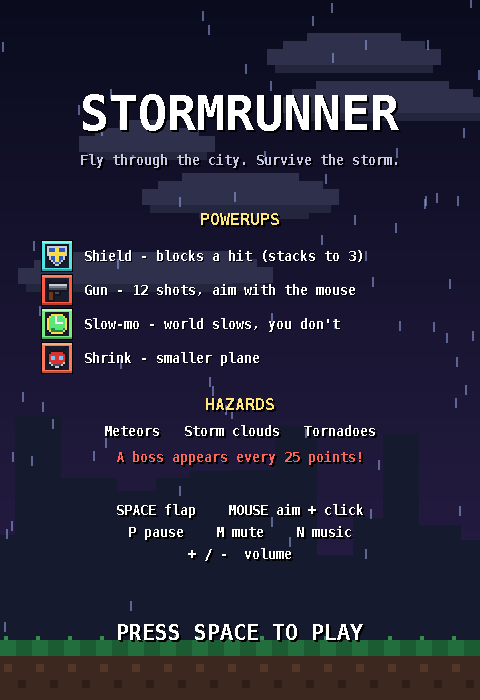
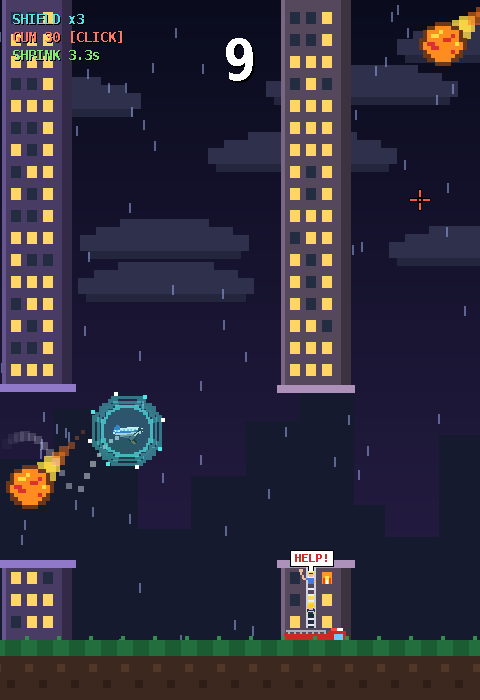
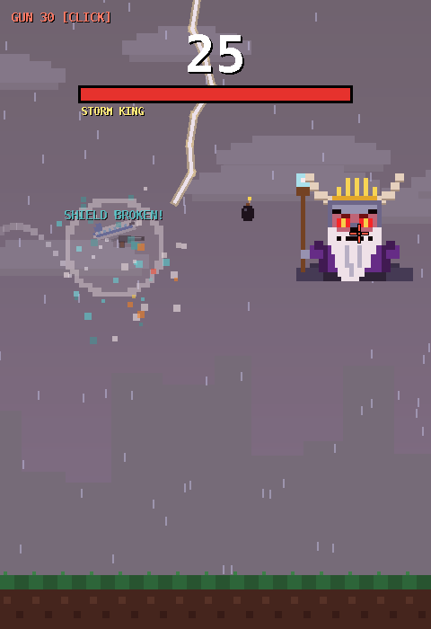

# Stormrunner

A pixel-art, Flappy Bird-style game written in **Java (Swing)**. You pilot a white commercial airliner through a stormy night city, dodging buildings, meteors, storm clouds and tornadoes, grabbing powerups, and fighting the horned **Storm King** every 25 points.

Everything is drawn and played from code: all pixel art, sound effects and music are generated by the program itself, so there are **no image or audio files** and **no external libraries**.



| Gameplay | Boss fight |
| --- | --- |
|  |  |

## Features

- **Flappy Bird-style flying:** flap through the gaps between buildings. Each pair you pass is a point, and the game gets faster and the gaps get tighter as your score climbs.
- **Hazards:** flaming meteors, storm clouds that warn and then zap lightning, and tornadoes you have to fly over.
- **A boss every 25 points:** the Storm King, with horns, a lightning crown, a beard and a staff. He fires aimed orbs, throws bombs in arcs, and sweeps the screen with lightning beams. He gets tougher each time you beat him.
- **Four powerups:** a stackable shield, a gun you aim with the mouse, slow-mo, and shrink.
- **Living city:** civilians wave for help from windows, fires flicker, and fire trucks park outside while firefighters climb ladders to rescue them. Ambulances and fire trucks race along the road.
- **Polish:** a vapor trail behind the plane, screen shake, explosions, a swiveling gun, a pixel crosshair, a title screen, pause menu, and a stormy background with rain and lightning.
- **Sound:** generated sound effects, a calm storm theme, and a faster boss theme, with volume control and mute.
- **Saved progress:** your high score and sound settings are saved between runs.

## How to play

### Controls

| Input | Action |
| --- | --- |
| **Space** | Flap (also starts and restarts the game) |
| **Mouse** | Aim the gun |
| **Left click** | Shoot (only while you have a gun) |
| **P** or **Esc** | Pause / resume |
| **Q** (while paused) | Quit to the title screen |
| **M** | Mute everything |
| **N** | Turn the music on or off |
| **+** / **-** | Volume up / down |

### Powerups

| Powerup | Effect |
| --- | --- |
| **Shield** | Blocks a hit. Shields **stack up to 3 layers**, and each hit pops one. |
| **Gun** | Adds 12 shots (up to 30) and mounts a gun under the plane. Aim with the mouse and click to fire. Bullets fly **through buildings** but are stopped by hazards. The gun disappears when you run out of ammo. |
| **Slow-mo** | Slows the world for 6 seconds, but **not your plane or your bullets**, so you get extra time to react. |
| **Shrink** | Makes the plane smaller for 7 seconds. |

### Hazards and the boss

- **Meteors** streak across the sky. One shot destroys one.
- **Storm clouds** flash a warning, then zap a short lightning bolt downward. They take two shots to destroy.
- **Tornadoes** stand on the ground and can't be destroyed. Fly over them.
- **The Storm King** appears at 25, 50, 75 points and so on. Shoot the orbs and bombs out of the air, find the gaps in his lightning beams, and empty his health bar. Beating him gives +10 points.

Tip: shooting a bomb makes it explode early, so try to do it while it is still far away from you.

## Getting started

### Requirements

- **Java 11 or newer** (developed with JDK 25). The game uses only the standard library (Swing, AWT and `javax.sound`), so there is nothing else to install.

### Run it in IntelliJ IDEA

1. Open the project folder in IntelliJ.
2. Make sure a JDK is selected under **File > Project Structure > Project**.
3. Open `src/Main.java` and click the green run button next to `main`.

### Run it from the command line

```bash
cd src
javac *.java
java Main
```

### Build a runnable JAR (optional)

```bash
cd src
javac *.java
jar cfe Stormrunner.jar Main *.class
java -jar Stormrunner.jar
```

### Troubleshooting sound

If you hear nothing, run the game from IntelliJ and look at the Run panel for lines starting with `[SoundManager]`. They list the audio devices Java found and any error. `SoundTest.java` is a small standalone program that plays a beep to check that Java audio works on your computer.

## Project structure

All source files are in the `src` folder (default package).

```
GameObject (abstract)             shared position, size, update() and draw()
├── Plane                         the player's airliner: gravity, flap, gun, shield layers
├── Building, BuildingPair        a building, and a top + bottom pair with a gap
├── Bullet                        a shot fired toward the cursor
├── PowerUp                       a floating pickup (its Type enum has per-powerup behavior)
├── Ground, StormBackground       scrolling ground; rain, clouds, skyline and lightning
├── VaporTrail                    the white trail behind the plane
├── Hazard (abstract)             anything dangerous
│   ├── Meteor
│   ├── StormCloud
│   ├── Tornado
│   ├── BossShot                  an energy orb fired by the boss
│   ├── Bomb                      a thrown bomb with an arc, fuse and blast
│   └── StormBoss                 the Storm King
├── EmergencyVehicle (abstract)   a vehicle driving along the road
│   ├── Ambulance
│   └── FireTruck
└── Effect (abstract)             short-lived visual effects
    ├── Explosion
    ├── Shockwave
    └── FloatingText

GamePanel      the game loop, spawning, collisions, HUD (extends JPanel)
Main           opens the window
SoundManager   generates and plays all sound effects and music
SaveData       saves the high score and sound settings
PixelArt, PowerUpIcons   helpers for pixel-art sprites
```

### Object-oriented design

| Concept | Where it shows up |
| --- | --- |
| **Inheritance** | Almost everything extends `GameObject`. `Meteor`, `StormCloud`, `Tornado`, `Bomb`, `BossShot` and `StormBoss` extend `Hazard`. `Ambulance` and `FireTruck` extend `EmergencyVehicle`. |
| **Polymorphism** | `GamePanel` calls `update()` and `draw()` on every kind of object without knowing its type. Subclasses override behavior: `StormCloud` and `StormBoss` override `hurts()` to include their lightning, `Tornado` overrides `damage()` to ignore bullets, and `Bomb` overrides it to detonate. Each `PowerUp.Type` constant overrides `apply()`, `pickupSound()` and `pickupText()`. |
| **Abstraction** | `GameObject`, `Hazard`, `EmergencyVehicle` and `Effect` are abstract and define what their subclasses must provide. |
| **Encapsulation** | The plane's shield layers, ammo and timers are private. Other classes use methods such as `activateShield()`, `takeHit()` and `shoot()`. `SoundManager` and `SaveData` hide their internals behind a small public API. |
| **Composition** | A `BuildingPair` has two `Building`s, a `Building` can own a parked `FireTruck`, and `GamePanel` holds lists of every object in the world. |

## Save data

Your high score, volume and music setting are stored in a small file in your home folder, `.stormrunner.properties`. Delete the file to reset them.

## Credits

Created by **[your name]** for **[course name]**.
All art, sounds and music are original and generated in code.
